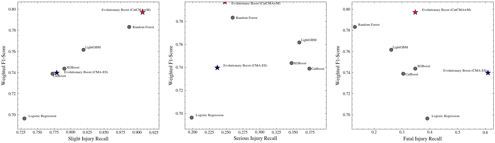
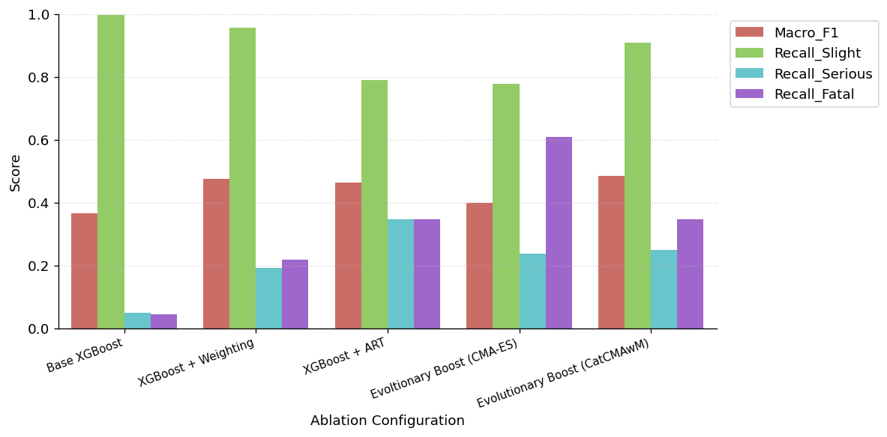
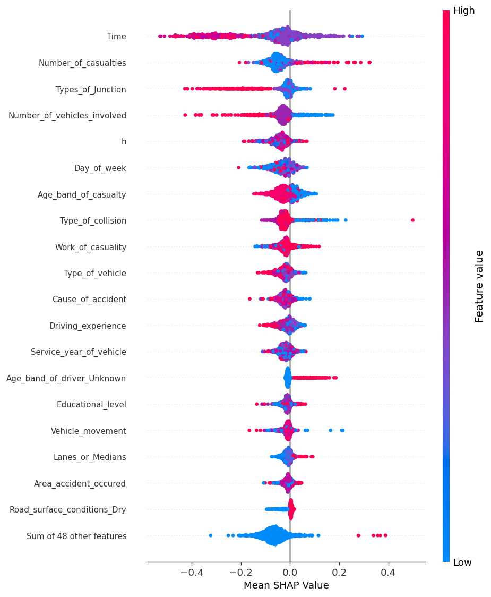

<div align="center">

# Evolutionary Boosting Using Categorical CMA-ES with Margin for Imbalanced Crash Injury Severity Prediction in Emergency Triage




-lightgrey)

</div>

---

## Table of Contents

- [Abstract](#abstract)
- [Key Contributions](#key-contributions)
- [Dataset](#dataset)
- [Methodology](#methodology)
- [Experimental Results](#experimental-results)
- [Repository Structure](#repository-structure)
- [Getting Started](#getting-started)
- [Reproducibility](#reproducibility)
- [Limitations and Future Work](#limitations-and-future-work)
- [Authors](#authors)
- [Citation](#citation)

---

## Abstract

Road traffic crashes cause millions of fatalities annually, and accurate identification of victim injury severity helps medical personnel prioritise patient handling. However, crash records are dominated by slight injury cases, which makes rare fatal outcomes difficult to detect. This project develops an evolutionary boosting model for post-crash emergency triage and compares two optimisers of an XGBoost classifier trained with Adaptive Resampling-based Training (ART): the Covariance Matrix Adaptation Evolution Strategy (CMA-ES) and the Categorical Covariance Matrix Adaptation Evolution Strategy with Margin (CatCMAwM).

On the test split, CatCMAwM achieved the highest accuracy (0.8074), Weighted F1 (0.7970), and Macro F1 (0.4852), as well as the lowest total misclassification cost (1,261.0 units). CMA-ES reached the highest fatal recall (0.6087) but produced 271 false fatal alarms and a lower Macro F1 (0.3992). These findings suggest that CatCMAwM is a more balanced configuration for supporting patient prioritisation, although its advantage over conventional models is modest and it should assist rather than replace clinical judgement.

## Key Contributions

1. **Evolutionary boosting framework.** An XGBoost classifier trained with a four-round ART cycle, whose hyperparameters are tuned jointly by an evolutionary optimiser through an ask-and-tell interface.
2. **Optimiser comparison.** A systematic comparison between continuous-relaxation CMA-ES and the mixed-variable CatCMAwM on a mixed continuous, integer, and categorical search space.
3. **Comprehensive evaluation.** Multiclass metrics, an ablation study, asymmetric misclassification cost analysis, statistical significance testing, computational cost analysis, and SHAP-based interpretability.

## Dataset

The experiments use the **Road Traffic Accident Dataset** (`RTA Dataset.csv`), which compiles urban traffic collision records from Addis Ababa, retrieved through the OpenCity open data initiative.

| Property | Value |
| --- | --- |
| Records | 12,316 |
| Predictor attributes | 32 (temporal, driver demographics, vehicle condition, roadway geometry, weather, and lighting) |
| Target variable | `Accident_severity` |
| Imbalance ratio (Slight : Fatal) | 65.92 : 1 |
| Highest missing proportions | `Defect_of_vehicle` (35.95%), `Service_year_of_vehicle` (31.89%) |

| Class | Samples | Proportion |
| --- | ---: | ---: |
| Slight Injury | 10,415 | 84.57% |
| Serious Injury | 1,743 | 14.15% |
| Fatal Injury | 158 | 1.28% |

The data are split in a stratified manner into 70% training (8,621 samples), 15% validation (1,847 samples), and 15% test (1,848 samples) subsets.

## Methodology

### Pipeline Overview

1. **Exploratory data analysis** of risk distribution patterns.
2. **Preprocessing** with leakage-free, training-only fitted transformations.
3. **Model training** of five baselines and two evolutionary boosting variants.
4. **Evaluation** on the independent test set through five verification stages: multiclass metrics, SHAP interpretation, ablation study, significance testing, and cost analysis.

### Data Preprocessing

- **Temporal feature engineering:** the crash hour `h` (0 to 23) is extracted from `Time`, and the original `Time` attribute is retained for minute-level granularity.
- **Feature grouping** by a uniqueness threshold of five: 17 high-cardinality, 12 low-cardinality, and 2 numerical features.
- **Encoding:** One-Hot Encoding for low-cardinality features and smoothed Target Encoding (smoothing = 0.2) for high-cardinality features, both fitted on the training set only.
- **Imputation:** distance-weighted K-Nearest Neighbors imputer with five neighbours.
- **Scaling:** Robust Scaler, based on the median and interquartile range.

### Adaptive Resampling-based Training (ART)

ART controls the training sample distribution over four consecutive rounds without generating synthetic data. Sampling probabilities start uniformly (one third per class) and are updated after each of the first three rounds according to the per-class validation F1-scores, so that more attention is allocated to poorly predicted classes. Samples are additionally weighted using one of three schemes: `none`, `sqrt`, or `effective_number`.

### Evolutionary Boosting

The optimiser (CMA-ES or CatCMAwM) searches six decision variables:

| Variable | Type | Domain |
| --- | --- | --- |
| Learning rate | Continuous | [0.03, 0.15], log-scaled |
| ART adaptation rate (`c_val`) | Continuous | [0.25, 0.70] |
| Fatal threshold scale | Continuous | [1.0, 4.0] |
| Serious threshold scale | Continuous | [1.0, 2.5] |
| Maximum tree depth | Integer | {6, 8, 10} |
| Class weighting scheme | Categorical | {`none`, `sqrt`, `effective_number`} |

Each candidate configuration trains an `XGBClassifier` (`n_estimators=100`, `subsample=0.8`, `colsample_bytree=0.8`) across the four ART rounds. The validation probabilities are multiplied by the threshold scale vector `[s_fatal, s_serious, 1.0]` to shift the decision boundary toward minority classes. Candidates are ranked by the following multi-criteria fitness, with a linear penalty when the Weighted F1 falls below 0.72:

```
Fitness = F1_weighted x (1.0 + 0.6 x Recall_fatal + 0.3 x Recall_serious) - 4.0 x max(0, 0.72 - F1_weighted)
```

The search runs for an evaluation budget of 100, and the configuration with the highest validation fitness is evaluated on the test set. CatCMAwM enforces a minimum probability margin on categorical distributions, which prevents categorical collapse and acts as a structural regulariser.

### Compared Models

Logistic Regression, Random Forest, LightGBM, CatBoost, XGBoost (all baselines), Evolutionary Boosting (CMA-ES), and Evolutionary Boosting (CatCMAwM).

### Evaluation Protocol

- **Metrics:** Accuracy, and Macro and Weighted Precision, Recall, and F1-Score.
- **Asymmetric cost matrix:** Fatal as Slight = 10.0, Serious as Slight = 5.0, Fatal as Serious = 4.0, and misclassification toward a higher severity level = 1.0.
- **Statistical tests:** Cochran's Q (omnibus), pairwise McNemar exact tests, Stuart-Maxwell tests, and paired permutation tests on Macro F1, with Holm-Bonferroni correction and 1,000 bootstrap iterations.
- **Interpretability:** TreeSHAP on the evolutionary boosting models.

## Experimental Results

All results are reported on the independent test set of 1,848 samples, which contains only 23 fatal cases.

### Multiclass Classification Performance

| Model | Accuracy | Precision (Macro) | Recall (Macro) | F1 (Macro) | Precision (Weighted) | Recall (Weighted) | F1 (Weighted) |
| --- | ---: | ---: | ---: | ---: | ---: | ---: | ---: |
| Logistic Regression | 0.6504 | 0.3622 | 0.4399 | 0.3501 | 0.7556 | 0.6504 | 0.6966 |
| Random Forest | 0.7895 | 0.4842 | 0.4260 | 0.4437 | 0.7782 | 0.7895 | 0.7833 |
| LightGBM | 0.7468 | 0.4651 | 0.4795 | 0.4693 | 0.7805 | 0.7468 | 0.7617 |
| CatBoost | 0.7100 | 0.4046 | 0.4835 | 0.4184 | 0.7786 | 0.7100 | 0.7390 |
| XGBoost | 0.7219 | 0.4476 | 0.4951 | 0.4634 | 0.7730 | 0.7219 | 0.7439 |
| Evolutionary Boosting (CMA-ES) | 0.6997 | 0.4245 | 0.5413 | 0.3992 | 0.7937 | 0.6997 | 0.7397 |
| **Evolutionary Boosting (CatCMAwM)** | **0.8074** | 0.4834 | 0.5013 | **0.4852** | 0.7900 | **0.8074** | **0.7970** |

Evolutionary Boosting with CatCMAwM attains the highest Accuracy, Macro F1, and Weighted F1. CMA-ES attains the highest fatal recall (0.6087, 14 of 23 fatal cases) and the highest Macro Recall (0.5413), whereas CatCMAwM attains a fatal recall of 0.3478. CMA-ES, however, generated 271 false fatal alarms (fatal precision of 0.0491), compared with a fatal precision of 0.2286 for CatCMAwM. CatCMAwM also achieved the highest slight injury recall (0.9079) and the highest serious injury precision (0.3495), although its serious injury recall (0.2481) was lower than that of the boosting baselines (0.3473 to 0.3740).

### Ablation Study

| Stage | Configuration | Principal Observation |
| --- | --- | --- |
| 1 | Base XGBoost | Majority class collapse: accuracy 0.8512, slight recall 0.9974, fatal recall 0.0435, serious recall 0.0496, Macro F1 0.3652. |
| 2 | + Square-root weighting | Fatal recall 0.2174, serious recall 0.1908, Macro F1 0.4746, Weighted F1 0.8107. |
| 3 | + ART (four rounds) | Fatal recall 0.3478 and serious recall 0.3473, at the cost of accuracy (0.7219) and Macro F1 (0.4634). |
| 4 | + CMA-ES | Fatal recall peaks at 0.6087, while serious recall (0.2366), slight recall (0.7786), and Macro F1 (0.3992) decline. |
| 5 | + CatCMAwM | Fatal recall 0.3478 is preserved, slight recall is restored to 0.9079, and the highest Macro F1 (0.4852) is obtained. |

<div align="center">

</div>

### Misclassification Cost and Computational Efficiency

| Model | Mean Cost | Cost Reduction vs. XGBoost (%) | Training Time (s) | Inference Latency (ms/sample) | Throughput (samples/s) | Total Cost |
| --- | ---: | ---: | ---: | ---: | ---: | ---: |
| Logistic Regression | 0.7825 | -10.47 | 74.90 | 0.00257 | 388,993 | 1,446.0 |
| Random Forest | 0.7192 | -1.53 | 3.46 | 0.04060 | 24,630 | 1,329.0 |
| LightGBM | 0.6910 | +2.44 | 7.02 | 0.01372 | 72,864 | 1,277.0 |
| CatBoost | 0.6959 | +1.76 | 8.07 | 0.00501 | 199,590 | 1,286.0 |
| XGBoost | 0.7083 | 0.00 | 4.77 | 0.00724 | 138,111 | 1,309.0 |
| Evolutionary Boosting (CMA-ES) | 0.6829 | +3.59 | 609.62 | 0.00448 | 223,342 | 1,262.0 |
| **Evolutionary Boosting (CatCMAwM)** | **0.6827** | **+3.67** | 383.50 | 0.00894 | 111,897 | **1,261.0** |

CatCMAwM yields the lowest total cost, although it is only 1.0 unit below CMA-ES. Its optimisation time is 37.1% shorter than that of CMA-ES (383.50 s versus 609.62 s). Because the evolutionary search is confined to the offline training phase, inference remains fast at 0.00894 ms per sample (111,897 samples per second).

### Statistical Significance

Cochran's Q test rejects the hypothesis of identical classification proportions across the seven models (Q = 371.2063, df = 6, p = 4.309e-77). Pairwise results for CatCMAwM against each competitor (Holm-Bonferroni corrected) are as follows.

| Comparison | McNemar | Stuart-Maxwell | Permutation (Macro F1) |
| --- | ---: | ---: | ---: |
| Logistic Regression | 7.60e-48 | 0.0000 | 0.0120 |
| Random Forest | 0.0296 | 8.73e-08 | 0.4036 |
| LightGBM | 1.18e-11 | 0.0000 | 0.4016 |
| CatBoost | 3.50e-23 | 0.0000 | 0.0120 |
| XGBoost | 1.19e-20 | 0.0000 | 0.2218 |
| Evolutionary Boosting (CMA-ES) | 5.34e-35 | 0.0000 | 0.0120 |

CatCMAwM shows statistically significant error differences against all six competing models (McNemar). Its Macro F1 gains are significant against Logistic Regression (+0.1337), CMA-ES (+0.0840), and CatBoost (+0.0650), whereas the differences against Random Forest, LightGBM, and XGBoost are not significant. This is expected, given that the test set contains only 23 fatal cases and that a single-instance prediction shift induces a large variance in macro-averaged metrics.

### Feature Importance (SHAP)

<div align="center">

</div>

- Both optimisers converge on the same primary determinants: the target-encoded timestamp (the dominant predictor), the extracted hour, the day of the week, junction type, number of casualties, number of vehicles involved, and collision type.
- In the CatCMAwM model, the number of casualties ranks second behind time, whereas CMA-ES places it third behind junction type.
- Driver educational level appears at the fifteenth rank in CatCMAwM but is absent from the top nineteen features of CMA-ES. This suggests that native mixed-space optimisation preserves subtle categorical interactions.
- The agreement with the patterns found in exploratory data analysis indicates that the framework extracts valid domain relationships rather than spurious correlations.

## Repository Structure

```
road-traffic-accident/
├── notebook.ipynb              # End-to-end experiment: EDA, preprocessing, modelling, evaluation
├── evolutionary_boosting.py    # Evolutionary boosting routines (CMA-ES and CatCMAwM) and class weighting
├── RTA Dataset.csv             # Addis Ababa Road Traffic Accident Dataset
├── outputs fix/                # Final figures and result tables (CSV) reported in the paper
├── pyproject.toml              # Project metadata and dependencies
├── uv.lock                     # Locked dependency versions
└── README.md
```

> [!NOTE]
> The notebook also imports `art_resampling` (`ARTDataset`, `art_refresh_dataset_from_predictions`), which implements the ART method. It is not included in this repository and must be available on the Python path. It follows the method proposed by Basandrai et al. (2025).

## Getting Started

### Prerequisites

- Python 3.13 or later
- [uv](https://docs.astral.sh/uv/) (recommended) or `pip`

### Installation

```bash
git clone <repository-url>
cd road-traffic-accident
uv sync
```

Alternatively, install the dependencies listed in [`pyproject.toml`](pyproject.toml) with `pip`.

### Running the Experiments

```bash
uv run jupyter lab notebook.ipynb
```

Run the notebook sequentially. Intermediate results are written to the `outputs/` directory, which must exist before the evaluation sections are executed.

## Reproducibility

- A global random seed of `42` is applied to NumPy, Python `random`, `PYTHONHASHSEED`, the data splits, and all models.
- All encoders, the imputer, and the scaler are fitted on the training set only, preventing information leakage from the validation and test sets.
- Reported results come from a single data split.

## Limitations and Future Work

**Limitations**

- Results derive from a single data split, and the test set contains only 23 fatal cases.
- The optimisation time of CatCMAwM (383.50 s) is considerably higher than that of conventional models (3.46 to 74.90 s).
- The serious injury recall of CatCMAwM (0.2481) is below that of the boosting baselines.
- Square-root weighted XGBoost already reaches a Macro F1 of 0.4746, so the full framework mainly raises fatal recall from 0.2174 to 0.3478.
- The proposed minimum probability margin mechanism was not tested in isolation.

**Future work**

- Validate the framework on larger multi-source datasets with repeated runs.
- Compare additional evolutionary optimisers.
- Apply multi-objective optimisation to raise fatal recall without increasing false alarms.
- Examine evaluation budgets larger than 100 and perform multi-objective cost matrix tuning.
- Perform cross-jurisdictional validation.

## Authors

Afan Ramadhan, Egy Destiar Firmandani, Fahmi Hidayat, and Diah Septiani

Department of Informatics, Telkom University, Purwokerto, Indonesia

## Citation

This work is currently a draft prepared for *Jurnal RESTI (Rekayasa Sistem dan Teknologi Informasi)*. Citation details will be updated upon publication.

```bibtex
@article{ramadhan2026evolutionary,
  title   = {Evolutionary Boosting Using Categorical CMA-ES with Margin for Imbalanced Crash Injury Severity Prediction in Emergency Triage},
  author  = {Ramadhan, Afan and Firmandani, Egy Destiar and Hidayat, Fahmi and Septiani, Diah},
  journal = {Jurnal RESTI (Rekayasa Sistem dan Teknologi Informasi)},
  year    = {2026},
  note    = {Draft manuscript}
}
```

